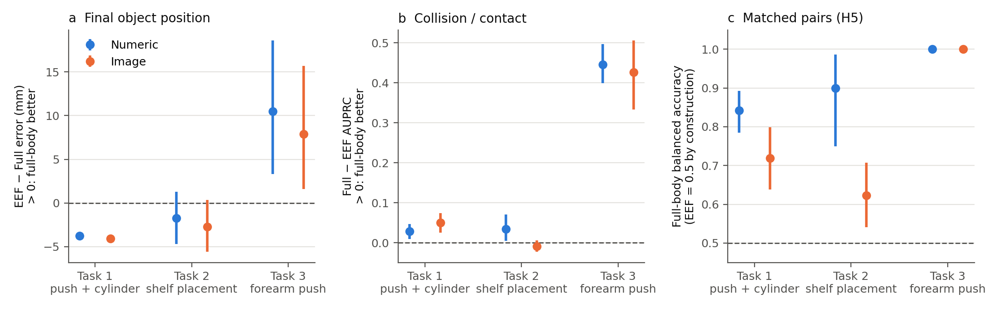
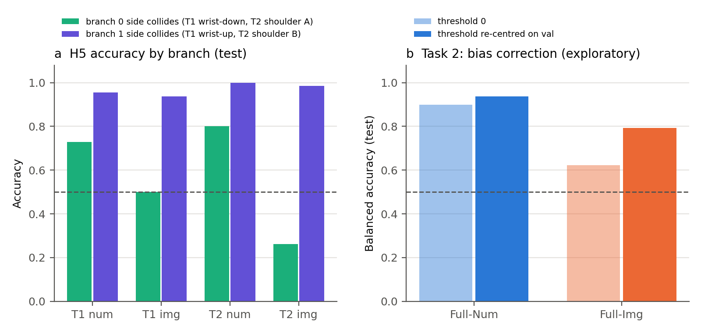

# 4 Results

*Draft, 2026-11-13. All values are on the test split of each task (used once), as the mean of 5 seeds with a 95% scene-level paired bootstrap CI. Sources: `Docs/encoder_fix/results_main_v1v2_ckpt/test_judgement.md`, `results_t2/test_judgement.md`, and `results_t3/test_judgement.md` with `t3_h1_test.md`.*

**Figure 4.1 – Full-body vs. end-effector on the three tasks.**
- (a) Difference in final object position error. Above 0 means the full-body model is better.
- (b) Difference in collision (Tasks 1, 2) or arm-contact (Task 3) AUPRC.
- (c) Balanced accuracy of the full-body model on matched pairs. EEF models are at 0.5 by construction.
- Blue: numeric. Orange: image. Bars: 95% CI.

## 4.1 Task 1: push with an obstacle (76 test scene pairs)

**Table 4.1 – Hypotheses, Task 1.**

| Hypothesis | Numeric | Image |
|---|---|---|
| H1: EEF not worse (Task A) | **supported** | **supported** |
| H2: collision AUPRC, Full − EEF | **supported**, +0.028 [+0.009, +0.047] | **supported**, +0.050 [+0.025, +0.074] |
| H3: image improves mask IoU | **not supported** | – |
| H4: lower collision rate and regret | not supported | not supported |
| H5: balanced accuracy | **supported**, 0.842 [0.785, 0.893] | **supported**, 0.719 [0.638, 0.799] |

**Table 4.2 – Main metrics, Task 1.**

| Metric | EEF-Num | Full-Num | EEF-Img | Full-Img |
|---|---|---|---|---|
| Final position error, Task A (mm) | **6.5** | 10.3 | 10.1 | 14.2 |
| Collision AUPRC, Task B | 0.796 | 0.824 | 0.777 | **0.828** |
| Mask IoU, Task A | **0.853** | 0.815 | 0.825 | 0.794 |
| Success rate of the selected candidate, Task B | **0.950** | 0.932 | 0.921 | 0.903 |
| Matched-pair accuracy (unbalanced) | 0.500 | **0.883** | 0.500 | 0.798 |

**H1.** Where the arm does not touch anything, the EEF models are not only within the margin but better.

- The position error is about 4 mm lower for both formats: −3.8 mm [−4.1, −3.5] numeric, −4.1 mm [−4.5, −3.7] image.

**H2 and H5.** The full-body models predict collisions better and distinguish matched pairs. Both effects pass the Holm correction for both formats.

**H3.** The image models have *lower* mask IoU than the numeric ones, by 0.021 to 0.029 with every CI below 0. So H3 is not supported.

**H4.** Better collision prediction does not translate into better selections. Only 5.4% of goal-reaching candidates collide, which leaves little room for a selection effect (a floor effect).

**Figure 4.2 – Branch bias in H5.**
- (a) Accuracy on pairs where the branch-0 or branch-1 candidate collides (test).
- (b) Task 2, exploratory: balanced accuracy when the decision threshold is re-centred on the validation set.

**Branch bias.** The full-body models are biased towards the branch that collides more often in training (Figure 4.2a).

- In Task 1, the image model is at chance (0.500) on pairs where the wrist-down side collides.
- On a separately generated H5 evaluation set (126 scene pairs, with more wrist-down collisions), balanced accuracy is 0.747 (numeric) and 0.603 (image).

## 4.2 Task 2: shelf placement (45 test scene pairs)

**Data.** Of 1131 matched pairs:

- 60 stop only on shoulder A;
- 188 stop only on shoulder B;
- 676 stop on both;
- 207 pass on both.

**Table 4.3 – Hypotheses, Task 2.**

| Hypothesis | Numeric | Image |
|---|---|---|
| **H5**: balanced accuracy | **supported**, 0.900 [0.750, 0.986] | **supported**, 0.623 [0.541, 0.707] |
| **H2**: protective-stop AUPRC, Full − EEF | **supported**, +0.034 [+0.005, +0.071] | not supported, −0.009 [−0.023, +0.006] |
| H1 (reported) | inconclusive | inconclusive |

**H5 and H2.** H5 replicates for both formats. H2 holds for numeric only.

- The EEF models already reach a stop AUPRC of about 0.88, because the gripper path alone determines most stops. This leaves little room for a gap.

**Exploratory analyses** (not part of the verdicts):

- **Compartment tightness.** Splitting by tightness into thirds (clearance = width / 2 − |offset|) shows no clear trend. The tight third stops in about 90% of cases, so AUPRC is near its ceiling for both models.
- **Image-model bias.** The image model ranks the two candidates of a pair correctly (AUROC 0.86), but its outputs are shifted by +0.09 towards shoulder B. Re-centring the threshold on validation raises its test balanced accuracy from 0.62 to 0.79 (Figure 4.2b).

## 4.3 Task 3: forearm pushing (45 test scene pairs)

**Data.** Of 765 matched pairs:

- 157 have contact only on shoulder A;
- 149 have contact only on shoulder B;
- 459 have no contact;
- none have contact on both.

A pushed box tips over and moves about 0.2 m.

**Table 4.4 – Hypotheses, Task 3.**

| Hypothesis | Numeric | Image |
|---|---|---|
| **H1′**: box position error, EEF − Full | **supported**, 35.6 → 25.1 mm, +10.5 [+3.3, +18.6], Holm p = 0.006 | **supported**, 35.0 → 27.1 mm, +7.9 [+1.6, +15.7], Holm p = 0.012 |
| **H5**: balanced accuracy | **supported**, 1.000 | **supported**, 1.000 |
| H2 (reported): arm-contact AUPRC, Full − EEF | +0.446 [+0.399, +0.497] | +0.426 [+0.333, +0.506] |

**The H1 effect reverses** (Figure 4.1a). When the arm moves the object, the full-body models predict the object's final position better in both formats.

- On validation, restricted to pairs where only one candidate touches the box, the error is about 100 mm for EEF and 63 mm for Full.

**H5 = 1.000 needs a caveat.** In this task, which shoulder touches is fully determined by which side of the path the box stands on: shoulder A whenever it is on the right, B whenever it is on the left (306 of 306 discordant pairs). A full-body model only has to learn this rule, so the perfect score reflects an easy discrimination rather than a strong model. The EEF models still cannot exceed 0.5.

## 4.4 Summary across tasks

| | Task 1 | Task 2 | Task 3 |
|---|---|---|---|
| Object position: Full better? | no (EEF better by ~4 mm) | no (n.s.) | **yes** (8–11 mm) |
| Collision/contact AUPRC: Full better? | yes (+0.03 / +0.05) | numeric only (+0.03) | **yes** (+0.43 / +0.45) |
| Matched pairs (H5) | yes | yes | yes (trivially separable) |

The advantage of the full-body representation grows with how much the outcome depends on the arm configuration. It is:

- absent for object position when the arm does not touch the object (Tasks 1 and 2);
- small for unintended collisions (Tasks 1 and 2);
- large when the arm is the tool (Task 3).
