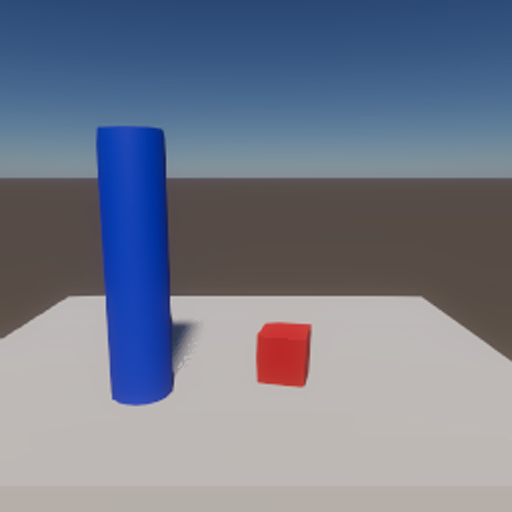
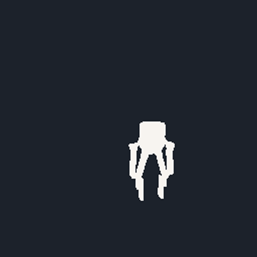
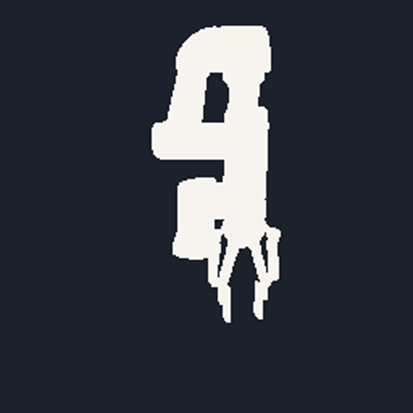
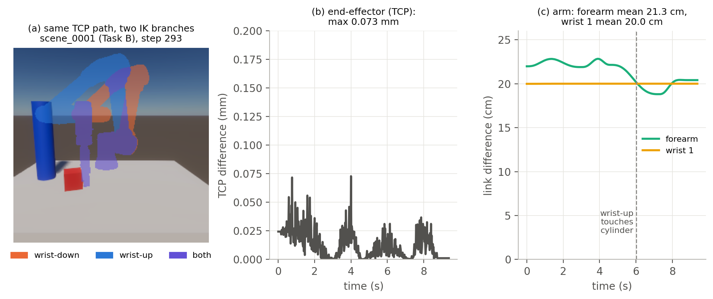
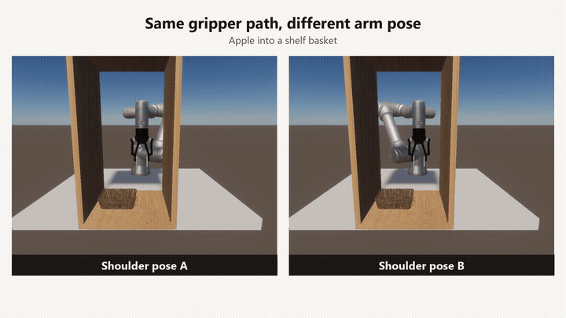
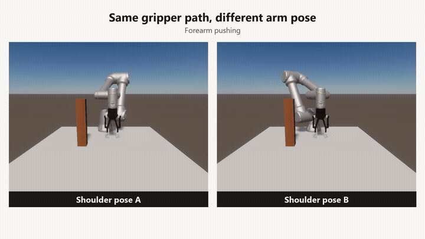
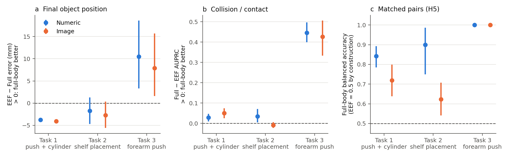

# How Much of the Robot Should a World Model See?

**Comparing end-effector and full-body action representations for robot–object prediction and planning**

BSc thesis project, Artificial Intelligence, Radboud University (2026–27) · Taro Kinoshita

A learned *world model* predicts what a robot's planned motion will do to the scene before the motion is executed. This project asks how much of the robot such a model needs to be told about:

- only the end-effector (the gripper's path), or
- the full body (every link of the arm).

We generate the data ourselves in Unity, train small world models from scratch, and compare them on three manipulation tasks.

> **Answer in one line:** the full-body representation helps in proportion to how much the outcome depends on the arm configuration.
> - It does not help where only the gripper touches the scene.
> - It helps for collisions with the arm.
> - It is clearly needed when the arm itself moves the object.

---

## The idea

### Four action representations (2 × 2)

| | **Numeric** | **Image** (rendered from the scene camera) |
|---|---|---|
| **End-effector (EEF)** | TCP position + orientation over time (7 values × 25 steps) | gripper mask + depth (2 ch × 25 steps) |
| **Full body** | joint angles + 9 link poses (69 values × 25 steps) | whole-robot mask + depth (2 ch × 25 steps) |

The four models are identical except for the action encoder. All actions come from the **planned** trajectory, never from the executed one. The initial scene image is taken with the robot hidden, so information about the robot reaches the model only through the action.

| Scene (robot hidden) | Action image · end-effector | Action image · full body |
|---|---|---|
|  |  |  |

### Matched pairs

The key control is the **matched pair**: two candidate trajectories with the same gripper path (TCP difference < 0.15 mm) but different inverse-kinematics solutions.

- An end-effector model receives identical input for both candidates, so it cannot tell them apart.
- A full-body model can, if it uses the arm.



---

## Three tasks

Simulated in Unity 6 with a UR5e arm and a Robotiq 2F-140 gripper (PhysX, 50 Hz, deterministic). The tasks are ordered by how much the outcome depends on the arm configuration.

| | Task 1: push with obstacle | Task 2: apple into a shelf basket | Task 3: forearm pushing |
|---|---|---|---|
| What happens | The gripper pushes a cube to a goal; a cylinder may be hit by the arm | The robot carries a held apple into a basket inside a shelf compartment; touching the shelf triggers a protective stop | The gripper passes a tall box without touching it; the forearm may push it over |
| Arm–object contact | unintended | unintended (stop) | **intended** |
| Matched pair | wrist-down / wrist-up | shoulder A / B | shoulder A / B |
| Data | 511 scene pairs, 16 candidates each | 300 scenes, 1131 pairs | 300 scenes, 765 pairs |

**Task 2:** same gripper path, two shoulder poses. With pose A the arm hits the shelf and stops; with pose B the apple is placed.



**Task 3:** with pose A the forearm pushes the box over; with pose B the box is untouched.



---

## Results

**Protocol.** Every task's hypotheses, data, splits and decision rules were written to [`Docs/encoder_fix/protocol.md`](Docs/encoder_fix/protocol.md) and committed **before** its data were generated or evaluated. Each test split was used once.

**Statistics.** 4 models × 5 seeds. 95% CIs come from a scene-level paired bootstrap.



### Task 1 (76 test scene pairs)

| Hypothesis | Numeric | Image |
|---|---|---|
| H1: EEF is not worse when nothing is hit (position, goal, ranking) | supported | supported |
| H2: full body predicts collisions better (AUPRC) | supported, +0.028 | supported, +0.050 |
| H3: images improve mask IoU | not supported (numeric better) | – |
| H4: full body selects safer trajectories | not supported | not supported |
| H5: full body distinguishes matched pairs (balanced accuracy) | **0.842** | **0.719** |

### Tasks 2 and 3 (45 test scene pairs each)

| | Task 2 numeric | Task 2 image | Task 3 numeric | Task 3 image |
|---|---|---|---|---|
| H5: matched pairs (balanced accuracy) | **0.900** | **0.623** | 1.000* | 1.000* |
| H2: collision / contact AUPRC, Full − EEF | +0.034 | −0.009 (n.s.) | +0.446 | +0.426 |
| Object position error, EEF − Full (mm) | n.s. | n.s. | **+10.5** | **+7.9** |

\* In Task 3, which shoulder touches the box is fully determined by the side the box is on, so H5 is an easy discrimination there.

### Why are image actions weaker? (exploratory)

**The images are correct:**

- the dataset camera matches Unity;
- rendered robot masks align within about 1.5 px;
- a rule with no learning reaches H5 ≈ 0.89 from the images alone.

**The gap comes from how the images are used:**

- **Late fusion.** Stacking the scene and action images into one encoder (early fusion) raises H5 by +0.08.
- **A learned branch bias.** In Task 2, re-centring the decision threshold raises the image model from 0.62 to 0.79.

Details: [`Docs/analysis_20261111/`](Docs/analysis_20261111/) and [`Docs/task2/results.md`](Docs/task2/results.md).

### Relation to prior work

| Prior work | Their finding | Here |
|---|---|---|
| Ganapathi et al. 2022 (Implicit Kinematic Policies) | Joint actions win where the elbow matters; Cartesian actions win for sweeping | Same split, now for world models |
| Khansari et al. 2020 (Action Image) | Action images stacked with the observation help | Early fusion closes part of the image gap |
| Wang 2025, Kim 2026, Alzayer 2026 | Image actions win in large pretrained video models | Fixed camera, one robot, small model: numeric is stronger |
| Yu et al. 2026 | Better prediction ≠ better decisions | H2 supported, H4 not (floor effect) |

---

## Repository layout

```
Assets/
  Scripts/          Task 1 data generation: scene generator, IK/FK, trajectory planner,
                    episode recorder, CPU rasteriser for action images
  Editor/           BatchRunner (Tools > P6 Batch): unattended, resumable batch generation
  Task2Pilot/       Tasks 2 and 3: Task2Recorder, Task3Recorder, contact probe, video capture
  Python/           Per-episode metadata, validation and label summaries (Task 1)
  ur5e_with_gripper/  Robot (URDF import)
Learning/
  wm_cache*.py      Episode folders → one HDF5 cache per task (128 px, 25 steps)
  wm_dataset.py     PyTorch dataset and scene-level splits
  wm_encoder_study.py  Model definition and training sweeps (plans main_ss5, t2_ss5, t3_ss5, …)
  wm_predict.py     Predictions with saved weights
  wm_eval*.py, wm_test_judge.py, wm_t3_judge.py   Metrics, bootstrap CIs, hypothesis verdicts
  thesis_figures.py Figures in Docs/thesis/fig
Docs/
  encoder_fix/protocol.md   Pre-registration log (entries 1–13)
  encoder_fix/results_*/    Logs, predictions and verdicts per experiment (weights are not committed)
  task2/, task3/            Design memos and results for the new tasks
  thesis/                   Thesis chapter drafts, figures, explainer videos
  THESIS_HANDOFF.md         Detailed project history (Japanese)
```

`Episodes/` (generated data, tens of GB) and model weights are not in the repository.

---

## Reproducing

**Environment**

- Unity **6000.0.84f1**, HDRP 17.0.4, Perception 1.0.0-preview.1, URDF Importer 0.5.2-preview.
- Python 3.11 with PyTorch 2.5 (CUDA), numpy, opencv-python, h5py, matplotlib, scipy.
- Training used an RTX 4060 Laptop (8 GB) and a rented RTX 4090. Twenty runs take about 50 minutes per task.

**Task 1**

1. Open `Assets/OutdoorsScene.unity` and run `Tools > P6 Batch > Start`.
2. Build the cache:
   ```
   python Learning/wm_cache.py --episodes Episodes/_main_v1 Episodes/_main_v2 --out Episodes/_main_v1v2/_cache/wm_128x25.h5
   ```
3. Train:
   ```
   python Learning/wm_encoder_study.py sweep --plan main_ss5 --cache Episodes/_main_v1v2/_cache/wm_128x25.h5 --out Docs/encoder_fix/results_main_v1v2_ckpt
   ```

**Tasks 2 and 3**

1. Open `Assets/Task2Pilot.unity` and enable `Task2Rec` or `Task3Rec`.
2. Press Play. 300 scenes take about 1.5 h at 8× time scale; runs resume where they stopped.
3. Build the cache, train and predict:
   ```
   python Learning/wm_cache_t2.py --episodes Episodes/_task2_v1          # or wm_cache_t3.py, Episodes/_task3_v1
   python Learning/wm_encoder_study.py sweep --plan t2_ss5 --cache Episodes/_task2_v1/_cache/wm_128x25.h5 --out Docs/encoder_fix/results_t2
   python Learning/wm_predict.py --runs Docs/encoder_fix/results_t2 --tag t2 --cache Episodes/_task2_v1/_cache/wm_128x25.h5 --train-cache Episodes/_task2_v1/_cache/wm_128x25.h5 --split val --name val
   ```
4. Use `--split test` **once**, after the protocol entry is committed. Then run `wm_test_judge.py` (with `WMJ_RUNS`, `WMJ_CACHE`, `WMJ_TAG`) and, for Task 3, `wm_t3_judge.py`.

**README images**

- `python Docs/readme/make_readme_images.py`
- The GIFs come from `Docs/thesis/video/*.mp4`:
  ```
  ffmpeg -ss 4 -i <video>.mp4 -vf "fps=12,scale=720:-1,split[a][b];[a]palettegen=max_colors=128[p];[b][p]paletteuse" <name>.gif
  ```

---

## Status

- Experiments on all three tasks are complete.
- The thesis is being written: drafts are in [`Docs/thesis/`](Docs/thesis/). Submission: January 2027.
- Supervisor: dr. Rekha Raja (Radboud University).
